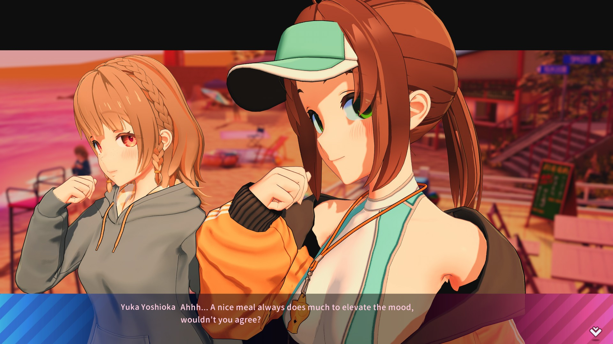
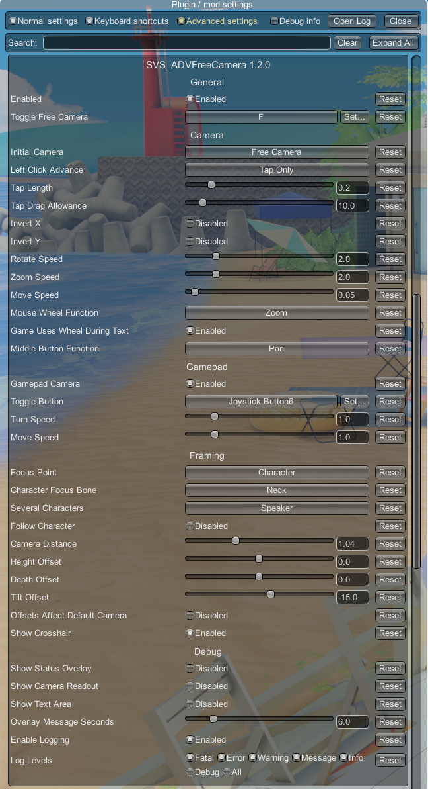

# SVS_ADVFreeCamera

A free camera for conversation scenes in **Summer Vacation Scramble**
(SamabakeScramble).

The game gives you a free camera in character creation and in H scenes, but
conversation (talk/ADV) scenes lock you to scripted angles. This plugin hands
those scenes the same camera you already know, and keeps the dialogue usable
while you move it.



## What it does

- **Free camera during conversations.** It takes over by itself once a character
  is in shot, and <kbd>F</kbd> hands the scene back or takes it again. Same
  controls as character creation, because it is the same camera component.
- **Left click still advances the dialogue.** A quick tap advances the line, a
  press and hold moves the camera. Three other modes are available if you would
  rather click only on the message frame, block click-advance entirely, or leave
  the game exactly as it was.
- **Optional centring on the character being spoken to**, on a bone of your
  choice from head down to feet, tracking them as they move.
- **Framing offsets** — distance, height, depth and tilt — which can apply to
  the game's own camera as well as ours.
- **Controller support.** Left stick pans, right stick turns, triggers move in
  and out.
- **Switch off the background blur and the black bars** of conversations, each
  on its own setting.
- The cursor hides while you drag the camera, and comes back where you pressed.
- Invert X and Y, adjustable speeds, and a rebindable toggle key.

## Requirements

- Summer Vacation Scramble
- BepInEx 6 for Unity IL2CPP, `6.0.0-be.752` — the build SVS-HF_Patch ships
- [BepInEx.ConfigurationManager](https://github.com/BepInEx/BepInEx.ConfigurationManager)
  to change settings in game (optional; the `.cfg` file works too)

Other camera plugins are fine alongside this one. SVS_3rdPov and SVS_PovX drive
`Camera.main`, which is the background camera during a conversation, not the one
this plugin takes over — tested with both enabled, with nothing misbehaving.

SVS Screenshot Expansion has a talk camera of its own on the same camera as this
one. When both are installed, its talk camera is switched off automatically so
the two do not fight; its screenshots keep working as normal. Turning this
plugin's Enabled setting off hands the camera back to it.

SVS_FreeRoam lets the left stick pick on-screen buttons during a conversation.
While the free camera is using that stick, this plugin asks it to wait; the D-pad
still picks buttons and choices.

## Installing

Drop `SVS_ADVFreeCamera.dll` into `<game>/BepInEx/plugins/`.

## Using it

Start a conversation and the free camera takes over once a character is in
shot. <kbd>F</kbd> switches it off and on. Set **Initial Camera** to
`DefaultCamera` if you'd rather every conversation start on the game's own
camera and only switch over when you press <kbd>F</kbd>.

| Input | Does |
|---|---|
| Left drag | Turn the camera |
| Left tap | Advance the dialogue |
| Right drag | Move in and out |
| Middle drag | Pan (or turn, if you prefer — it is configurable) |
| Mouse wheel | Advances the text while it is up, as in the game; otherwise zooms (or turns) |
| Left stick | Pan |
| Right stick | Turn the camera |
| Right / left trigger | Move in / out |
| Select (Back / View) | Free camera on and off |

**Left Click Advance** decides how clicking and the dialogue share the left
button:

| Mode | Behaviour |
|---|---|
| `TapOnly` (default) | A quick tap advances, a press and hold moves the camera |
| `TextAreaOnly` | Advances only when you click the message frame |
| `Never` | Click and wheel never advance while the camera is up |
| `Normal` | The game untouched — dragging the camera advances too |

Choices are always clickable, in every mode.

## Settings



**General** — Enabled, Toggle Free Camera (<kbd>F</kbd>).

**Camera** — Initial Camera, Left Click Advance, Tap Length, Tap
Drag Allowance, Invert X, Invert Y, Rotate Speed, Zoom
Speed, Move Speed, Mouse Wheel Function, Game Uses Wheel During Text, Middle
Button Function.

**Gamepad** — Gamepad Camera, Toggle Button, Turn Speed, Move Speed. Xbox-style controllers
(XInput), which covers most pads under Steam Input.

**Framing** — Focus Point (leave the shot alone, centre on the speaker, or
resume where you left it), Several Characters (with two or three on screen:
whoever is talking, all of them, or the one you like most), Follow Character,
Character Focus Bone, Camera Distance, Height Offset,
Depth Offset, Tilt Offset, Offsets Affect Default Camera, Show Crosshair, Show
Background Blur, Show Background Frame.

**Debug** — Show Status Overlay, Show Camera Readout, Show Text Area, Overlay
Message Seconds, Enable Logging, Log Levels.

Every setting carries its own description in ConfigurationManager.

## Known limitations

None known. [FINDINGS.md](FINDINGS.md) records how the game was worked out and
what was tried.

## Building

You need the .NET SDK. The project compiles against the interop assemblies that
sit next to your game under `BepInEx\SamabakeScramble\interop` — an SVS-HF_Patch
install already has them, and BepInEx generates them on first run otherwise. Point
the build at yours:

```bash
cp Local.props.example Local.props
```

Edit `Local.props` so `InteropPath` is your own
`BepInEx\SamabakeScramble\interop` folder, then:

```bash
dotnet build SVS_ADVFreeCamera.sln
```

The DLL lands in `SVS_ADVFreeCamera/bin/Debug/net6.0/SVS_ADVFreeCamera.dll`. `Local.props`
is not tracked by git, so your path stays yours. You can also pass the path
directly:

```bash
dotnet build SVS_ADVFreeCamera.sln -p:InteropPath="C:\Games\SVS\BepInEx\SamabakeScramble\interop"
```

`nuget.config` adds the BepInEx feed, since `BepInEx.Unity.IL2CPP` is not on
nuget.org.

### Why interop assemblies rather than the IllusionLibs packages

Most SVS plugins reference `IllusionLibs.SamabakeScramble.*`. This one does not,
because no published version matched the install it was developed against — the
interop assemblies and `GameAssembly.dll` disagreed on hash. Referencing the
local interop folder guarantees that what it compiles against is exactly what
loads at runtime.

## How it works

It does not drive the camera by hand. It attaches the game's own
`ILLGames.Unity.CameraController` — the component character creation and H scenes
use — to the conversation camera, and configures it.

That is harder than it sounds, and nearly every line of the setup exists because
a simpler version was tried and failed. [FINDINGS.md](FINDINGS.md) is the record:
the fields `Awake` needs before it will run, why the component must never be
destroyed, how the dialogue's own click gate works, which bone to centre on, and
a list of approaches that were measured not to work. Read it before changing
anything.

## Credits

Built from
[TonWonton/BepInEx_Il2CppPluginTemplate](https://github.com/TonWonton), itself
based on [SpockBauru/BepInEx_IL2CPP_Template](https://github.com/SpockBauru/BepInEx_IL2CPP_Template)
and [IllusionMods/PluginTemplate](https://github.com/IllusionMods/PluginTemplate).

The design follows Mantas-2155X's
[TalkFreeCamera](https://github.com/Mantas-2155X/TalkFreeCamera) for Koikatsu:
attach the game's own camera component rather than fighting it for control.

Thanks to the SVS plugin community — TonWonton, DarkSoldier27 and IllusionMods —
whose published source answered questions no decompiler could.
